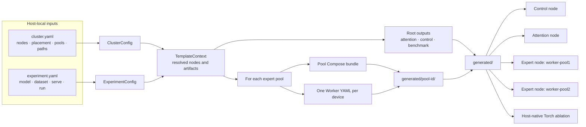

# Ascend deployment configuration

`dev/ascend` turns two human-readable YAML inputs into concrete Compose and
runtime configuration for an EK deployment. Pydantic validates the inputs,
resolves node and artifact references, and constructs one `TemplateContext` for
strict Jinja templates. Generated files stay project-local and are never author
inputs.

The [Ascend deployment tutorials](../../doc/tutorial/ascend/README.md) contain
the common deployment workflow and model-specific checkpoint, geometry,
memory, and qualification requirements.

## Inputs and ownership

| File | Owns | Lifecycle |
| --- | --- | --- |
| `configs/qwen3-30b-a3b/*.example.yaml` | Qwen3 cluster and experiment pair | Checked in |
| `configs/qwen3-30b-a3b-w8a8/*.example.yaml` | Qwen3 W8A8 cluster, smoke experiment, and benchmark | Checked in |
| `configs/deepseek-v4-flash-w8a8/*.example.yaml` | V4 W8A8 cluster, smoke experiment, and benchmark | Checked in |
| `configs/deepseek-v3/*.example.yaml` | DeepSeek-V3 BF16 cluster and experiment pair | Checked in |
| `configs/cluster.yaml` | Host addresses, placement, devices, ports, images, and paths | Host-local and ignored |
| `configs/experiment.yaml` | Model, dataset adapter, serving, and benchmark settings | Host-local and ignored |
| `templates/*.jinja` | Runtime and Compose output shapes | Checked in |
| `generated/` | Rendered Compose and runtime YAML | Generated and ignored |

All Host-side inputs and outputs remain inside the EK checkout under the
operator's home directory. Paths such as `/etc/expert-kit` in generated Compose
files are container-side mount targets. Deployment values do not come from a
`.env` file.

### `cluster.yaml`

`cluster.yaml` describes where the deployment runs:

- `project_name` supplies the stable Compose resource prefix;
- `attention` and `control` bind the frontend services to a node;
- `expert.runtime` supplies limits shared by every expert Worker;
- `pools` binds each expert node to its devices and published port ranges;
- `nodes` maps logical node names to routable Host addresses;
- `paths` maps model and dataset references to Host paths.

`project_name` is a Compose namespace. It is separate from
`inference.instance_name`, which identifies the EK runtime instance.

### Multi-pool placement

Each `PoolConfig` represents the Workers deployed on one expert node:

```yaml
pools:
  - id: worker-pool1
    node: node-b
    devices: [0, 1, 2, 3]
    start_worker_port: 53234
    start_peer_port: 54234

  - id: worker-pool2
    node: node-c
    devices: [0, 1, 2, 3]
    start_worker_port: 53234
    start_peer_port: 54234
```

Pool IDs must be unique. An ID becomes both a generated directory name and a
Compose project-name suffix. The generator creates one Worker per device. Port
ranges may be reused across different nodes because each range is bound to that
node's Host address.

Worker filenames and Compose service names are pool-local, so both pools may
contain `worker-00`. The runtime Worker ID is pool-qualified, for example
`worker-pool1-worker-00`, and is globally unique when it registers with the
Controller.

The example is an 8A32E deployment: eight attention ranks on `node-a`, sixteen
expert Workers in `worker-pool1`, and sixteen in `worker-pool2`. The current
topology keeps attention and control together and uses one pool per expert node.

### `experiment.yaml`

`experiment.yaml` describes what to run:

- model identity, dtypes, `path_ref`, and optional model-fact assertions;
- dataset parser, label name, and optional `path_ref`;
- vLLM serving limits;
- optional `tracing` settings for Frontend and Worker traces;
- prompt count, concurrency, output length, warmups, and sampling settings.

`model.path_ref` indexes `cluster.paths.models`. A file-backed dataset's
`dataset.path_ref` indexes `cluster.paths.datasets`.

| Dataset type | Required path fields | Prompt length |
| --- | --- | --- |
| `random` | None | `run.input_len` is required |
| `sharegpt` | `path_ref`, `mounted_path`, `file` | Read from the dataset; omit `run.input_len` |
| `custom` | `path_ref`, `mounted_path`, `file` | Read from the dataset; omit `run.input_len` |

`dataset.name` is a human-readable result-label component. `dataset.type`
selects the benchmark parser.

`tracing.enabled` defaults to false. When enabled, supply a plaintext OTLP/gRPC
`tracing.endpoint` reachable from the attention and Worker containers. The
generator applies the same `tracing.sample_ratio` to both roles and enables
vLLM eager execution. See the [tracing tutorial](../../doc/tutorial/inference-tracing.md)
for the short run and Jaeger UI procedure. `serve.enforce_eager` independently
keeps eager execution on when tracing is disabled, which is useful for an
overhead comparison.

## Ascend graphs

`experiment.ascend_decode_graph` contains only Frontend graph choices: `mode`,
`capture_sizes`, `timeout_seconds` and optional `rendezvous_host`/`rendezvous_port`
overrides. The shared options validator sorts and deduplicates capture sizes without adding
buckets. Omit the mapping for ordinary execution. See the
[graph guide](../../doc/tutorial/ascend/decode-graphs.md) for the existing Qwen3/V4
examples and pinned prebuilt runtime.

Choose Worker counts, devices and hosts in the normal cluster pools. Each graph
pool additionally declares `start_graph_control_port`; the generator gives each
Worker its own `control_listen` and `control_advertise`. These ports are separate
from ordinary Transport and peer-weight ports. Only the Frontend receives the
options JSON. No generated document declares expert ownership or a session ID.

Start Workers, use ordinary `ek-cli schedule rebalance` (or the existing manual,
static or duplicate commands), and wait for the target instance's experts to be
READY before starting the Frontend. The Frontend builds its graph session from
native vLLM/Hugging Face model facts and the Controller's READY snapshot. Workers
resolve model facts from Weight Server metadata and check PREPARE against those
resolved facts. Noncontinuous expert IDs, different layer
assignments and replicas do not need a second placement manifest. The old
`schedule graph` command now fails with migration instructions before accessing
configuration or services.

Worker startup resolves model dimensions, expert computation, clipping and
quantization from Weight Server metadata before complete validation. Examples
omit these repeated facts. Explicit model declarations remain optional assertions
and must match metadata. The generator performs no network lookup or additional
Hugging Face parsing.

Native Frontend loading options belong under `serve`: `quantization`,
`load_format`, `safetensors_load_strategy`, `distributed_executor_backend`,
`trust_remote_code` and `compilation_mode`. The W8A8 examples set
`serve.quantization: ascend`; V4 also specifies its native loading and compilation
options. `compilation_mode` accepts a native string or integer mode. Existing
explicit `model.quantization` and `model.expert_compute: deepseek_v4` declarations
retain their previous Frontend defaults when the corresponding `serve` option is
omitted. An explicit `serve` value takes precedence, including `false`; `null`
suppresses the compatibility default and leaves that native key absent.

`serve.max_num_seqs`, `max_num_batched_tokens`, `max_num_scheduled_tokens`,
`block_size`, `num_gpu_blocks_override`, `kv_cache_memory_bytes` and
`enable_chunked_prefill` are optional native settings. Unspecified values stay
absent in generated serving YAML. The graph does not force a 64-request,
2048-token or 128-block configuration. Omit the KV block override to use native
memory planning. Full graph steps and running requests are bounded by the native
resolved allocation and compatible captures; Decode-only ordinary Prefill keeps
its native token budget. Native startup reports effective limits.

Multiple hosts and pools are accepted; known device and port collisions are
checked per host. After READY selection, the first selected Worker in Worker-ID
order binds and retains the graph TCPStore before the Frontend starts HCCL.
By default, its advertised graph-control host supplies the rendezvous host and
the OS assigns the actual listener port. Either `rendezvous_host` or
`rendezvous_port` may be overridden independently. An explicit host must reach
that Worker; an explicit port conflict fails without choosing another port.
The generator checks rendezvous port collisions only when both overrides are
known. Multi-host configuration acceptance is not NPU qualification.

Keep graph execution/tracing settings compatible with the selected runtime.
After related placement, weights or participating processes change, stop incoming
work, drain and restart affected graph processes to rebuild the session while
retaining containers. There is no automatic recapture or eager retry after a
partially submitted graph failure. Device qualification of changed configurations
remains separate from successful generation.

## Benchmark examples

The two W8A8 directories keep `experiment.example.yaml` for small smoke runs
and provide `bench.example.yaml` as a complete experiment input for the earlier
online benchmark settings. Both benchmark examples use Full graphs and the
existing cluster's `ascend_fused` Workers, variable-length ShareGPT prompts,
128 output tokens with EOS ignored, and concurrency 64 with 256 requests.
These files preserve settings; they do not report a new benchmark of current code.

Copy the benchmark and its existing cluster into the ignored local inputs:

```bash
profile=qwen3-30b-a3b-w8a8  # Or deepseek-v4-flash-w8a8.
cp dev/ascend/configs/$profile/cluster.example.yaml dev/ascend/configs/cluster.yaml
cp dev/ascend/configs/$profile/bench.example.yaml dev/ascend/configs/experiment.yaml
```

Fill in model/results paths and replace `192.0.2.10` in the cluster input.
If adding a rendezvous host override, update that address too.
Keep `attention.devices: [0]` and use eight Workers: change the Qwen pool's
`devices` to `[1, 2, 3, 4, 5, 6, 7, 8]`; the V4 pool already uses those devices.
Add the directory containing `frozen.json` to `cluster.paths.datasets`:

```yaml
paths:
  datasets:
    sharegpt: "<FROZEN_SHAREGPT_DIR>"
```

Keep the other `paths` entries. The benchmark container mounts this directory
read-only at `/workload`. Use the same ordered, frozen 1024 ShareGPT samples
across models and comparison arms, with no reshuffling or oversampling. The
earlier workload kept first turns unchanged from conversations with at least
two turns, accepting prompts of 4–1024 tokens under both model tokenizers and
requiring prompt length + 128 ≤ 2048. Exact reproduction requires the same
`frozen.json`; an unfiltered ShareGPT download is a different workload. Omit
`run.input_len` for these variable-length inputs.

Generate with the existing command, then follow the
[deployment workflow](../../doc/tutorial/ascend/README.md) through Worker READY
and Frontend startup before running the benchmark container:

```bash
uv run python dev/ascend/cli.py generate \
  --cluster dev/ascend/configs/cluster.yaml \
  --experiment dev/ascend/configs/experiment.yaml \
  --output dev/ascend/generated
dev/ascend/run-compose.sh attention run --rm benchmark
```

For the full sweep, set `run.max_concurrency` to C and `run.num_prompts` to 4C:

| C | Requests |
| ---: | ---: |
| 1 | 4 |
| 4 | 16 |
| 16 | 64 |
| 64 | 256 |
| 128 | 512 |
| 256 | 1024 |

Each window uses the first 4C samples of the frozen file. At each C, generate
the matching inputs and run two complete warmup windows followed by three
measured windows, keeping each window's results separate. `run.num_warmups: 0`
controls vLLM's CLI warmup count; those two full warmup windows are separate
benchmark invocations. Report medians from measured windows. `vllm bench serve`
reports whole-request HTTP latency and throughput, including TTFT, TPOT, ITL,
and end-to-end percentiles; these are not internal Prefill/Decode device TPS.

## File tree

```text
dev/ascend/
├── README.md
├── cli.py                          # Typer generate command
├── generate.py                     # output expansion
├── renderer.py                     # StrictUndefined Jinja renderer
├── bench_launcher.py               # vLLM benchmark YAML adapter
├── run-compose.sh                  # selects image, control, attention, or pool Compose
├── schemas/                        # input and template-context models
├── configs/
│   ├── qwen3-30b-a3b/
│   │   ├── cluster.example.yaml
│   │   └── experiment.example.yaml
│   ├── qwen3-30b-a3b-w8a8/          # cluster, smoke experiment, and benchmark
│   ├── deepseek-v4-flash-w8a8/       # cluster, smoke experiment, and benchmark
│   ├── deepseek-v3/
│   │   ├── cluster.example.yaml
│   │   └── experiment.example.yaml
│   ├── cluster.yaml                # ignored Host-local input
│   └── experiment.yaml             # ignored Host-local input
├── compose/
│   └── compose.build.yaml          # standalone image-build defaults
├── templates/
│   ├── compose.build.yaml.jinja
│   ├── compose.control*.yaml.jinja
│   ├── compose.attention*.yaml.jinja
│   ├── compose.expert*.yaml.jinja
│   ├── controller.yaml.jinja
│   ├── worker.yaml.jinja
│   ├── vllm-serve.yaml.jinja
│   ├── vllm-bench.yaml.jinja
│   └── torch-bench.yaml.jinja
└── generated/                      # ignored exact materialization
    ├── .expert-kit-generated       # cleanup safety marker
    ├── compose.build.yaml
    ├── compose.control.dev.yaml
    ├── compose.control.yaml
    ├── compose.attention.dev.yaml
    ├── compose.attention.yaml
    ├── controller.yaml
    ├── vllm-serve.yaml
    ├── vllm-bench.yaml
    ├── torch-bench.yaml            # ShareGPT only
    ├── worker-pool1/
    │   ├── compose.expert.dev.yaml
    │   ├── compose.expert.yaml
    │   └── workers/worker-NN.yaml
    └── worker-pool2/
        ├── compose.expert.dev.yaml
        ├── compose.expert.yaml
        └── workers/worker-NN.yaml
```

The generated `compose.build.yaml` uses the image references from
`cluster.yaml`; `compose/compose.build.yaml` remains the standalone build file
with repository defaults. Build through the generated definition as described
in the [common deployment workflow](../../doc/tutorial/ascend/README.md#3-build-the-images).

## Data flow



Node and artifact contexts retain their source configuration together with the
resolved node or path. Their serializers flatten that structure for templates,
so Jinja uses values such as `attention.address`, `pool.address`, `model.path`,
and `dataset.mounted_path` directly.

`cli.py` generates configuration only. Host preflight, artifact distribution,
and service lifecycle orchestration remain outside this prototype and are
documented as operator steps in the deployment tutorials.
