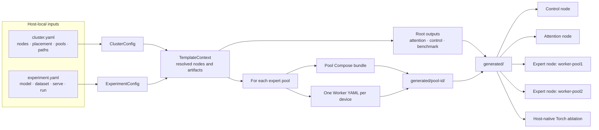

# Ascend deployment configuration

`dev/ascend` turns two human-readable YAML inputs into concrete Compose and
runtime configuration for an EK deployment. Pydantic validates the inputs,
resolves node and artifact references, and constructs one `TemplateContext` for
strict Jinja templates. Generated files stay project-local and are never author
inputs.

The [Ascend deployment tutorials](../../doc/tutorial/ascend/README.md) contain
the common deployment workflow and model-specific checkpoint, geometry,
memory, and qualification requirements.

## Inputs and ownership

| File | Owns | Lifecycle |
| --- | --- | --- |
| `configs/qwen3-30b-a3b/*.example.yaml` | Qwen3 cluster and experiment pair | Checked in |
| `configs/qwen3-30b-a3b-w8a8/*.example.yaml` | Single-host Qwen3 W8A8 graph pair | Checked in |
| `configs/deepseek-v4-flash-w8a8/*.example.yaml` | Single-host V4 W8A8 graph pair | Checked in |
| `configs/deepseek-v3/*.example.yaml` | DeepSeek-V3 BF16 cluster and experiment pair | Checked in |
| `configs/cluster.yaml` | Host addresses, placement, devices, ports, images, and paths | Host-local and ignored |
| `configs/experiment.yaml` | Model, dataset adapter, serving, and benchmark settings | Host-local and ignored |
| `templates/*.jinja` | Runtime and Compose output shapes | Checked in |
| `generated/` | Rendered Compose and runtime YAML | Generated and ignored |

All Host-side inputs and outputs remain inside the EK checkout under the
operator's home directory. Paths such as `/etc/expert-kit` in generated Compose
files are container-side mount targets. Deployment values do not come from a
`.env` file.

### `cluster.yaml`

`cluster.yaml` describes where the deployment runs:

- `project_name` supplies the stable Compose resource prefix;
- `attention` and `control` bind the frontend services to a node;
- `expert.runtime` supplies limits shared by every expert Worker;
- `pools` binds each expert node to its devices and published port ranges;
- `nodes` maps logical node names to routable Host addresses;
- `paths` maps model and dataset references to Host paths.

`project_name` is a Compose namespace. It is separate from
`inference.instance_name`, which identifies the EK runtime instance.

### Multi-pool placement

Each `PoolConfig` represents the Workers deployed on one expert node:

```yaml
pools:
  - id: worker-pool1
    node: node-b
    devices: [0, 1, 2, 3]
    start_worker_port: 53234
    start_peer_port: 54234

  - id: worker-pool2
    node: node-c
    devices: [0, 1, 2, 3]
    start_worker_port: 53234
    start_peer_port: 54234
```

Pool IDs must be unique. An ID becomes both a generated directory name and a
Compose project-name suffix. The generator creates one Worker per device. Port
ranges may be reused across different nodes because each range is bound to that
node's Host address.

Worker filenames and Compose service names are pool-local, so both pools may
contain `worker-00`. The runtime Worker ID is pool-qualified, for example
`worker-pool1-worker-00`, and is globally unique when it registers with the
Controller.

The example is an 8A32E deployment: eight attention ranks on `node-a`, sixteen
expert Workers in `worker-pool1`, and sixteen in `worker-pool2`. The current
topology keeps attention and control together and uses one pool per expert node.

### `experiment.yaml`

`experiment.yaml` describes what to run:

- model identity, shape, dtypes, and `path_ref`;
- dataset parser, label name, and optional `path_ref`;
- vLLM serving limits;
- optional `tracing` settings for Frontend and Worker traces;
- prompt count, concurrency, output length, warmups, and sampling settings.

`model.path_ref` indexes `cluster.paths.models`. A file-backed dataset's
`dataset.path_ref` indexes `cluster.paths.datasets`.

| Dataset type | Required path fields | Prompt length |
| --- | --- | --- |
| `random` | None | `run.input_len` is required |
| `sharegpt` | `path_ref`, `mounted_path`, `file` | Read from the dataset; omit `run.input_len` |
| `custom` | `path_ref`, `mounted_path`, `file` | Read from the dataset; omit `run.input_len` |

`dataset.name` is a human-readable result-label component. `dataset.type`
selects the benchmark parser.

`tracing.enabled` defaults to false. When enabled, supply a plaintext OTLP/gRPC
`tracing.endpoint` reachable from the attention and Worker containers. The
generator applies the same `tracing.sample_ratio` to both roles and enables
vLLM eager execution. See the [tracing tutorial](../../doc/tutorial/inference-tracing.md)
for the short run and Jaeger UI procedure. `serve.enforce_eager` independently
keeps eager execution on when tracing is disabled, which is useful for an
overhead comparison.

## Fixed Ascend graphs

`experiment.ascend_decode_graph` optionally accepts the shared graph deployment
fields: session/instance/Worker/weight identity, control and rendezvous endpoints,
routed layer IDs, capture sizes and timeout. It defaults to absent. The
[Qwen3/V4 graph guide](../../doc/tutorial/ascend/decode-graphs.md) describes
the example pairs, shared prebuilt runtime image and startup commands. The
[V2-Lite notes](../../doc/tutorial/ascend/deepseek-v2-lite-decode-graphs.md)
record its different model geometry and historical qualification.

The generator validates one host, one Frontend and one expert pool on distinct
devices, matching identity, unused graph ports and one active Worker batch.
It accepts the fixed V2-Lite and Qwen3 profiles, and eight ordered 32-expert
shards for the exact ModelSlim V4 profile. It emits `ascend-decode-graph.json`,
identical Worker settings, Frontend identity/mounts and native
`FULL_DECODE_ONLY` flags by default (`mode: decode`). All participants use host
networking even when ordinary Prefill Transport is gRPC.

For Qwen3-30B-A3B W8A8, `mode: full` also captures Prefill and mixed steps.
In a local copy of the Qwen3 example, use `cluster.expert.backend: torch` or
`ascend_fused` and set `experiment.ascend_decode_graph.mode: full`, retaining all
48 layers and the two 64-expert Worker intervals. Use capture sizes
`[1, 2, 4, 8, 16, 32, 64, 128, 256, 512, 1024, 2048]`. The generator selects native
`FULL`, a 2,048-token step budget and `max-num-seqs: 64`; token capacity and request
count are separate limits. Both modes reuse the shared prebuilt 0.26 runtime;
enabling full mode requires no additional native build. V2-Lite and V4 continue
to use `mode: decode`. The checked-in examples keep their existing defaults.

For V2-Lite, two Workers require explicit, disjoint desired placement of experts
0..31 and 32..63 on every routed layer; the generator does
not create these Controller assignments. Start the Frontend only after actual
READY routes prove all 1,664 experts have the declared owner and process start ID.

DeepSeek-V4-Flash W8A8 requires a vLLM-Ascend build with native V4 support.
V4 generation selects the native `mp` executor to keep the TP=1 native executor's
KV-cache configuration separate from scheduler-derived block sizes.
Declare 43 layers, 256 experts, hidden size 4096, intermediate size 2048 and
top-k 6, with these additional model fields:

```yaml
expert_compute: deepseek_v4
swiglu_limit: 10.0
quantization:
  type: modelslim-w8a8-dynamic
  bits: 8
  group_size: null
  symmetric: true
```

Set `layer_ids` to all integers from 0 through 42 and declare eight complete
intervals in `ascend_decode_graph.workers`. Place the Frontend and eight Workers
on separate devices. The generator writes matching Worker declarations and the native
Ascend quantization setting. Controller placement must make all 11,008 experts
READY in those declared shards before the Frontend starts. The V2-Lite recipe's
expert counts and placement do not apply to V4.

After Workers register, `ek-cli schedule graph --graph-config <generated-json>
--wait-ready-seconds 1800` installs the declared expert placement and waits for
readiness. Run it with the generated Controller configuration, automatic
assignment disabled and the Frontend stopped. Do not run another scheduling
operation concurrently. Qwen3 requires 6,144 routed experts READY; V4 requires
11,008. See the graph guide for the complete Compose command.

The V2-Lite qualification results belong to the historical runtime recorded
in its notes. They do not qualify the new prebuilt 0.26 image or Qwen3/V4 on
that image. Full serving and graph replay require target-server validation.

## File tree

```text
dev/ascend/
├── README.md
├── cli.py                          # Typer generate command
├── generate.py                     # output expansion
├── renderer.py                     # StrictUndefined Jinja renderer
├── bench_launcher.py               # vLLM benchmark YAML adapter
├── run-compose.sh                  # selects image, control, attention, or pool Compose
├── schemas/                        # input and template-context models
├── configs/
│   ├── qwen3-30b-a3b/
│   │   ├── cluster.example.yaml
│   │   └── experiment.example.yaml
│   ├── qwen3-30b-a3b-w8a8/          # single-host graph example pair
│   ├── deepseek-v4-flash-w8a8/       # single-host graph example pair
│   ├── deepseek-v3/
│   │   ├── cluster.example.yaml
│   │   └── experiment.example.yaml
│   ├── cluster.yaml                # ignored Host-local input
│   └── experiment.yaml             # ignored Host-local input
├── compose/
│   └── compose.build.yaml          # standalone image-build defaults
├── templates/
│   ├── compose.build.yaml.jinja
│   ├── compose.control*.yaml.jinja
│   ├── compose.attention*.yaml.jinja
│   ├── compose.expert*.yaml.jinja
│   ├── controller.yaml.jinja
│   ├── worker.yaml.jinja
│   ├── vllm-serve.yaml.jinja
│   ├── vllm-bench.yaml.jinja
│   └── torch-bench.yaml.jinja
└── generated/                      # ignored exact materialization
    ├── .expert-kit-generated       # cleanup safety marker
    ├── compose.build.yaml
    ├── compose.control.dev.yaml
    ├── compose.control.yaml
    ├── compose.attention.dev.yaml
    ├── compose.attention.yaml
    ├── controller.yaml
    ├── vllm-serve.yaml
    ├── vllm-bench.yaml
    ├── torch-bench.yaml            # ShareGPT only
    ├── worker-pool1/
    │   ├── compose.expert.dev.yaml
    │   ├── compose.expert.yaml
    │   └── workers/worker-NN.yaml
    └── worker-pool2/
        ├── compose.expert.dev.yaml
        ├── compose.expert.yaml
        └── workers/worker-NN.yaml
```

The generated `compose.build.yaml` uses the image references from
`cluster.yaml`; `compose/compose.build.yaml` remains the standalone build file
with repository defaults. Build through the generated definition as described
in the [common deployment workflow](../../doc/tutorial/ascend/README.md#3-build-the-images).

## Data flow



Node and artifact contexts retain their source configuration together with the
resolved node or path. Their serializers flatten that structure for templates,
so Jinja uses values such as `attention.address`, `pool.address`, `model.path`,
and `dataset.mounted_path` directly.

`cli.py` generates configuration only. Host preflight, artifact distribution,
and service lifecycle orchestration remain outside this prototype and are
documented as operator steps in the deployment tutorials.
